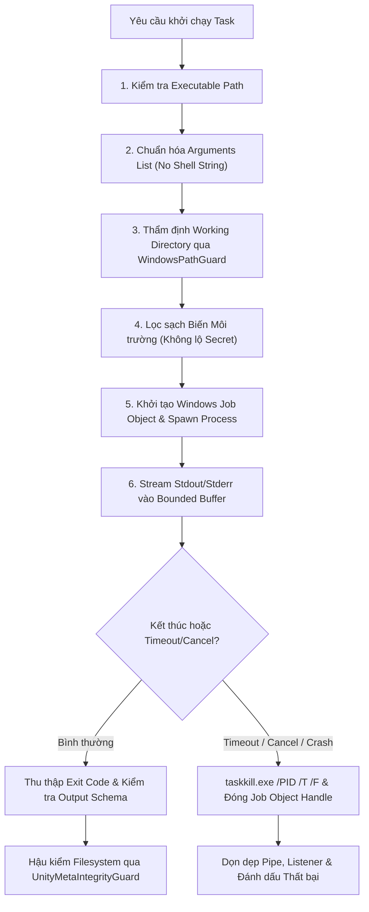

# G2.6 Windows Runtime Isolation, Process Management & Security Architecture

> **Tài liệu Kiến trúc Bảo mật & Quản lý Tiến trình trên Windows 11**  
> **Dự án:** Personal AI Studio (`C:\AI-Studio`)  
> **Tác giả:** Antigravity AI Engineering Team  
> **Ngày phê duyệt:** 2026-10-31  

---

## 1. Tuyên ngôn Bảo mật Cốt lõi (Fundamental Security Principles)

1. **PermissionEngine không phải là OS Sandbox:**
   `PermissionEngine` là tầng kiểm soát logic bên trong ứng dụng Personal AI Studio. Khi một CLI bên ngoài (như `codex-cli`, `python`, `node`) được khởi chạy thành tiến trình độc lập của hệ điều hành, nó kế thừa toàn bộ quyền hạn Windows của tài khoản người dùng đang đăng nhập (`User Token`). Nếu không có cơ chế sandbox cấp nhân (Kernel/OS level), tiến trình đó có thể đọc/ghi bất kỳ tệp tin nào mà tài khoản Windows có quyền truy cập, hoàn toàn vượt ngoài tầm với của các hàm kiểm tra trong JavaScript/TypeScript.
2. **Windows Job Objects không bảo vệ Filesystem:**
   Windows Job Objects là cơ chế quản lý vòng đời và tài nguyên (giới hạn CPU, RAM, thời gian thực thi, diệt toàn bộ cây tiến trình con khi cha bị đóng). **Job Objects không có tính năng hạn chế đọc/ghi tệp tin (No Filesystem Access Control).** Tuyệt đối không được tuyên bố rằng việc đưa tiến trình vào Job Object là đã "cô lập an toàn Workspace".
3. **Không chạy CLI tự do trên Project Unity thật:**
   Không bao giờ khởi chạy một AI Agent có quyền ghi trực tiếp vào thư mục mã nguồn Unity thật chỉ dựa vào việc PermissionEngine trả về `ALLOWED`. Nếu chưa có OS-level isolation được xác minh, mọi tác vụ can thiệp mã nguồn phải chạy qua **Staging Workspace** hoặc ở chế độ **`restricted`** buộc Owner phê duyệt từng hành động.

---

## 2. Bảng So sánh Các Cơ chế Cô lập Tiến trình trên Windows

| Tiêu chí | Windows Job Objects | Windows Sandbox | Windows AppContainer / Restricted Token | Staging Workspace (Copy-on-Write) |
|---|---|---|---|---|
| **Giới hạn Đọc Filesystem** | ❌ Không | ✅ Tuyệt đối (VM cô lập) | ⚠️ Một phần (cần cấu hình ACL chặt) | ❌ Không (tiến trình vẫn thấy ổ đĩa nếu không bị chặn) |
| **Giới hạn Ghi Filesystem** | ❌ Không | ✅ Tuyệt đối (mất khi tắt VM) | ⚠️ Giới hạn trong package folder | ⚠️ Giới hạn trên thư mục staging (nếu CLI tuân thủ working dir) |
| **Giới hạn Network** | ❌ Không | ⚠️ Cấu hình qua vSwitch | ✅ Hạn chế qua AppContainer SID | ❌ Không |
| **Quản lý Cây Tiến trình** | ✅ Tuyệt đối (`JOB_OBJECT_LIMIT_KILL_ON_JOB_CLOSE`) | ✅ Tuyệt đối (nằm trọn trong VM) | ⚠️ Cần cấu hình kèm Job Object | ✅ Quản lý qua Job Object / `taskkill /T /F` |
| **Yêu cầu Quyền Administrator** | ❌ **Không cần** (User thường chạy được) | ⚠️ Yêu cầu kích hoạt Hyper-V / Admin | ⚠️ Cần cấu hình token / tạo SID chuyên biệt | ❌ **Không cần** (Hoạt động hoàn toàn ở user-space) |
| **Yêu cầu Windows Edition** | Mọi bản Windows (Home, Pro, Enterprise) | Chỉ có trên Windows Pro / Enterprise | Windows 8+ (Mọi bản) | Mọi hệ điều hành |
| **Độ trễ khởi chạy** | Cực thấp (< 10ms) | Rất cao (15 – 45 giây boot VM) | Trung bình (50 – 100ms) | Thấp (phụ thuộc tốc độ copy diff: 100 – 500ms) |
| **Tương thích CLI & Unity 2D** | ✅ 100% tương thích | ❌ Rất kém (thiếu Unity Editor, thiếu cache package) | ⚠️ Kém (nhiều CLI Node/Python lỗi khi thiếu quyền user token đầy đủ) | ✅ Rất cao (giữ nguyên cấu trúc file để kiểm tra) |
| **Khả năng triển khai an toàn trong G2.6** | ✅ **Áp dụng ngay cho Process Lifecycle** | ⏸️ Không tự ý bật tính năng hệ thống | ⏸️ Chỉ áp dụng khi có công cụ xác minh | ✅ **Áp dụng làm cơ chế phòng vệ chính (Staging Guard)** |

> [!CAUTION]
> **Quy định bất khả xâm phạm:** Personal AI Studio tuyệt đối không tự ý bật Windows Features (Hyper-V, Windows Sandbox), không tự ý cài đặt driver/service ngầm, và không yêu cầu quyền UAC Administrator khi chưa được Owner phê duyệt bằng văn bản.

---

## 3. Kiến trúc Process Runner An toàn (`ProcessRunner`)

Để quản lý vòng đời tiến trình một cách an toàn và ngăn chặn các lỗ hổng thực thi lệnh (Command Injection), `ProcessRunner` tuân thủ các nguyên tắc sau:

### 3.1 Chống Command Injection
- **Không bao giờ dùng Shell nối chuỗi:** Tuyệt đối không gọi `child_process.exec("cmd.exe /c " + user_input)` hoặc chắp nối chuỗi powershell.
- **Sử dụng danh sách đối số riêng biệt:** Chỉ sử dụng `child_process.spawn(executablePath, argsArray, { shell: false })` với mảng đối số tách rời, ngăn chặn việc chèn ký tự điều khiển `;`, `&`, `|`, `` ` ``.

### 3.2 Bounded Output Buffer (Chống tràn RAM)
- Giới hạn kích thước buffer tối đa cho mỗi tiến trình (mặc định: `10MB`).
- Nếu tiến trình AI xuất log hoặc dữ liệu lặp vô tận, tiến trình sẽ tự động bị ngắt với mã lỗi `BUFFER_OVERFLOW` để bảo vệ tài nguyên hệ thống, không làm crash Electron Main Process.

### 3.3 Hủy tiến trình con triệt để
- Khi hủy tác vụ (`cancelTask`) hoặc hết thời gian (`timeout`), hệ thống kích hoạt lệnh hủy toàn bộ cây tiến trình:
  `taskkill.exe /PID <pid> /T /F`
- Đảm bảo không để lại bất kỳ tiến trình con nào (mồ côi) chạy ngầm chiếm dụng CPU hoặc khóa tệp tin trên đĩa.

---

## 4. Cơ chế Staging Workspace & Defense-in-Depth

Vì Windows chưa hỗ trợ sandbox filesystem nhẹ không cần quyền Administrator, Studio áp dụng giải pháp **Staging Workspace kết hợp Pre/Post Snapshot**:

1. **Thư mục Staging tạm thời:**
   Khi Agent cần can thiệp tệp tin, Studio tạo một thư mục staging tại `storage/staging/<session_id>/`.
2. **Snapshot trước khi thực thi:**
   Tạo snapshot tự động `before_agent_execution` của các file liên quan bằng `WorkspaceSnapshotService`.
3. **Thực thi có kiểm soát:**
   CLI chỉ được truyền working directory trỏ vào thư mục Staging.
4. **Hậu kiểm tính toàn vẹn (Post-Execution Integrity Verification):**
   - Kiểm tra xem có file nào ngoài phạm vi cho phép bị chỉnh sửa không.
   - Nếu là Unity Project: Chạy `UnityMetaIntegrityGuard` để quét 4 loại lỗi: `missing_meta`, `orphan_meta`, `duplicate_guid`, `invalid_guid`.
5. **Cổng Phê duyệt Áp dụng (Apply Gate):**
   - Nếu phát hiện vi phạm `.meta`: Đánh dấu `critical_meta_violation`, dừng toàn bộ quá trình, giữ lại snapshot và thông báo cho Owner. **Tuyệt đối không tự động sao chép đè vào Project thật.**
   - Chỉ khi toàn bộ kiểm tra hậu kiểm đạt trạng thái `healthy`, hệ thống mới trình bản so sánh (Diff) cho Owner và chỉ áp dụng vào thư mục gốc khi có sự đồng ý của Owner.

---

## 5. Trạng thái Vận hành của Runtime trong G2.6

Để bảo đảm tính trung thực kỹ thuật theo yêu cầu của Owner:
- Đối với **Google Antigravity:** Đặt ở chế độ `manual_only` (khuyến nghị chạy trực tiếp trong VS Code).
- Đối với **OpenAI Codex:** Đặt ở chế độ `restricted` (chỉ chạy khi có xác nhận của Owner hoặc chạy trên Workspace thử nghiệm/staging).
- Đối với **Anthropic Claude:** Đặt ở chế độ `not_installed` (chờ cài đặt CLI).

Hệ thống ghi nhận rõ ràng các giới hạn bảo mật này trong toàn bộ báo cáo và giao diện người dùng, không tạo cảm giác an toàn giả tạo.

