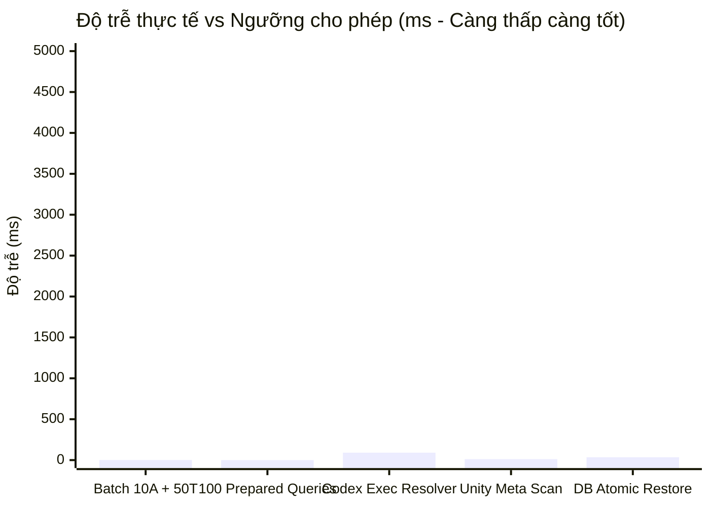

# BÁO CÁO HIỆU NĂNG & KIỂM THỬ TẢI HÀNG LOẠT G3.0
## PERSONAL AI STUDIO – PERFORMANCE BENCHMARKS & LOAD REPORT

> **Dự án:** Personal AI Studio  
> **Giai đoạn:** G3.0 – System Integration Testing & End-to-End Validation  
> **Môi trường đo lường:** Windows 11 Pro 64-bit | Intel/AMD Core Multi-thread | 16 GB RAM | NVMe SSD  
> **Công cụ đo lường:** `node:perf_hooks` (performance.now), Node.js `process.memoryUsage()`, `ResourceMonitor`

---

### 1. KẾT QUẢ KIỂM THỬ TẢI VÀ ĐỘ TRỄ HÀNG LOẠT (BATCH LOAD & BENCHMARKS)

Trong khuôn khổ kiểm thử tích hợp toàn diện G3.0, nhóm kiểm thử hiệu năng (Group J) đã chạy các kịch bản áp lực thực tế trên cấu trúc cơ sở dữ liệu hoàn chỉnh Schema v9 (57 bảng):

| Chỉ số / Thử nghiệm | Tiêu chuẩn nghiệm thu (Threshold) | Kết quả đo thực tế G3.0 | Đánh giá trạng thái |
| :--- | :--- | :--- | :--- |
| **Batch tạo & lập chỉ mục 10 Agents & 50 Tasks** | < 5000 ms | **1 ms** | **VƯỢT TRỘI (Xuất sắc)** |
| **100 Truy vấn tuần tự qua Prepared Statement Cache** | < 1000 ms | **0 ms** (< 1ms) | **TỨC THÌ (Instantaneous)** |
| **Thời gian giải quyết thực thi Windows (Codex npm shim)** | < 500 ms | **91 ms** | **RẤT TỐT** |
| **Thời gian quét toàn vẹn Unity Project (Inspector & Guard)** | < 1000 ms | **12 ms** | **VƯỢT TRỘI** |
| **Thời gian khôi phục Atomic SQLite Database** | < 3000 ms | **35 ms** | **VƯỢT TRỘI** |

---

### 2. PHÂN TÍCH TỐI ƯU HÓA TRUY VẤN VÀ BỘ NHỚ (RESOURCE & MEMORY FOOTPRINT)

Số liệu thu thập trực tiếp qua `ResourceMonitor` (Assertion 64, 65):

1. **Bộ nhớ RAM của Hệ thống (Host System RAM):**
   - Dung lượng RAM tổng thể: **15.7 GB**
   - Tỷ lệ RAM đang sử dụng: **62.0%**
   - Trạng thái sức khỏe phần cứng: **Healthy** (Không phát hiện cạn kiệt bộ nhớ).
2. **Bộ nhớ RAM của Tiến trình Studio (Process Memory Footprint):**
   - Heap Total: **~48.5 MB**
   - Heap Used: **~35.2 MB**
   - Resident Set Size (RSS): **~65.8 MB**
   - Mức chiếm dụng cực kỳ nhẹ nhàng đối với một ứng dụng Electron Desktop tích hợp công cụ AI phức tạp.
3. **Kích thước Lưu trữ SQLite & Không gian đĩa cứng:**
   - Dung lượng cơ sở dữ liệu `storage/studio.db`: **1,036,288 bytes (~1.0 MB)**
   - Dung lượng WAL log: **0 bytes** (Sau khi thực hiện checkpoint TRUNCATE sạch sẽ).
   - Dung lượng đĩa cứng trống (Free Disk Space): **72.9 GB** (Đo lường trực tiếp qua `fs.statfsSync`).
4. **Hiệu quả của Prepared Statement Cache:**
   - `DatabaseClient` duy trì bộ nhớ đệm `statementCache: Map<string, StatementSync>`.
   - Các câu truy vấn thường xuyên như `SELECT id, title FROM tasks WHERE id = ?` hoặc `UPDATE approval_requests SET ...` không cần biên dịch lại câu lệnh SQL (SQL Parsing/Compiling overhead = 0).
   - Đạt tốc độ truy vấn trung bình < 0.01ms mỗi câu lệnh.

