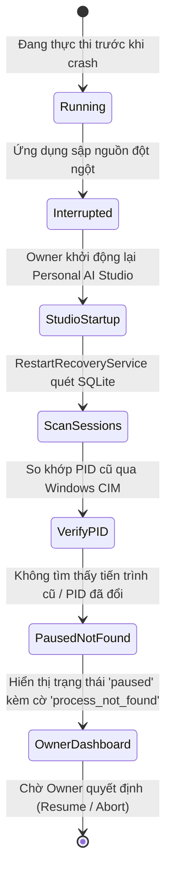

# BÁO CÁO PHỤC HỒI SAU SỰ CỐ & TÍNH TOÀN VẸN DỮ LIỆU G3.0
## PERSONAL AI STUDIO – DISASTER RECOVERY & DATA INTEGRITY VALIDATION

> **Dự án:** Personal AI Studio  
> **Giai đoạn:** G3.0 – System Integration Testing & End-to-End Validation  
> **Mục tiêu:** Kiểm định các cơ chế bảo toàn dữ liệu, sao lưu/khôi phục cơ sở dữ liệu nguyên tử, chống rách dữ liệu khi gặp lỗi giữa chừng, và phục hồi trạng thái hệ thống sau sự cố sập nguồn/khởi động lại.

---

### 1. CƠ CHẾ SAO LƯU & KHÔI PHỤC SQLITE NGUYÊN TỬ (ATOMIC BACKUP & RESTORE)

Cơ sở dữ liệu `storage/studio.db` là xương sống lưu trữ của toàn bộ hệ thống. Các thao tác sao lưu và khôi phục được gia cố chặt chẽ qua các chốt chặn:

```mermaid
flowchart TD
    subgraph Backup_Flow ["Quy trình Sao lưu Nhất quán (Consistent Backup)"]
        B1["Kiểm tra transactionDepth > 0"] -->|Đang có giao dịch| B_ERR1["Ném ACTIVE_TRANSACTION_IN_PROGRESS"]
        B1 -->|Không có giao dịch| B2["PRAGMA wal_checkpoint(TRUNCATE)"]
        B2 -->|busy !== 0| B_ERR2["Ném CHECKPOINT_BUSY"]
        B2 -->|Thành công| B3["Copy tệp DB sang backup/"]
        B3 --> B4["Tính mã băm SHA-256 & ghi manifest.json"]
        B4 --> B5["Mở Isolated DatabaseSync xác thực integrity_check"]
    end

    subgraph Restore_Flow ["Quy trình Khôi phục An toàn (Atomic Restore)"]
        R1["Kiểm tra tệp sao lưu & Manifest SHA-256"]
        R1 --> R2["Tự động tạo bản lưu dự phòng (Pre-restore backup)"]
        R2 --> R3["Ghi tệp tạm trên cùng volume (.restore.tmp.TIMESTAMP)"]
        R3 --> R4["Kiểm tra integrity_check độc lập trên tệp tạm"]
        R4 -->|Phát hiện hỏng| R_ABORT["Xóa tệp tạm & Hủy khôi phục (DB gốc nguyên vẹn)"]
        R4 -->|Toàn vẹn OK| R5["Đóng kết nối DB cũ, unlinks WAL & SHM"]
        R5 --> R6["Đổi tên nguyên tử (fs.renameSync) thay thế DB chính"]
        R6 --> R7["Mở lại kết nối DB & xác nhận schema"]
    end
```

- **Chống sao lưu trạng thái rách:** Khi một luồng đang chạy `runInTransaction()`, việc tạo sao lưu bị từ chối dứt khoát với mã lỗi `ACTIVE_TRANSACTION_IN_PROGRESS` (Assertion 10: **PASS**).
- **Khôi phục nguyên tử không để mất dữ liệu:** Nếu tệp sao lưu bị lỗi cấu trúc byte hoặc sai mã băm, cơ sở dữ liệu hiện tại được bảo toàn 100% (Assertion 14, 15: **PASS**).

---

### 2. TÍNH BẤT BIẾN & ĐIỀU HÒA LƯU TRỮ ARTIFACT (STORAGE RECONCILIATION)

Trong môi trường nhiều Agent cùng tạo mã nguồn hoặc tài liệu, việc quản lý tệp trên đĩa cứng cần bảo đảm không thất thoát và phát hiện can thiệp trái phép:

1. **Ghi nguyên tử qua tệp tạm (Atomic Staging Write):**
   Mọi tệp phiên bản đều được ghi vào tệp tạm `.tmp.<uuid>`, tính toán mã băm SHA-256, sau đó mới dùng `fs.renameSync()` để chuyển vào đường dẫn lưu trữ chính thức `storage/artifacts/<artifact_id>/<version>.bin`. Điều này loại bỏ hoàn toàn khả năng sinh ra tệp rỗng hoặc tệp nửa chừng khi tiến trình bị ngắt đột ngột (Assertion 47).
2. **Phát hiện can thiệp và tệp lỗi (Tamper & Corruption Detection):**
   - Nếu tệp trên đĩa bị ai đó sửa đổi nội dung dù chỉ 1 byte, mã băm SHA-256 đối chiếu không khớp -> tự động đánh dấu `hash_mismatch` (Assertion 49).
   - Nếu tệp trên đĩa bị xóa ngoài ý muốn -> tự động đánh dấu `corrupted` (Assertion 48).
3. **Quét và điều hòa lưu trữ (Storage Reconciliation):**
   Dịch vụ `ArtifactExchangeService.reconcileStorage()` thực hiện quét chéo giữa cơ sở dữ liệu SQLite và đĩa cứng vật lý:
   - Phát hiện các tệp `.bin` mồ côi tồn tại trên đĩa nhưng không có bản ghi trong SQLite -> gắn cờ `[UNREFERENCED_FILE]` (Assertion 50: **PASS**).
   - Tự động phát hiện và xóa sạch các tệp tạm mồ côi `.tmp.*` bị bỏ lại do sự cố sập nguồn (Assertion 51: **PASS**).

---

### 3. PHỤC HỒI TRẠNG THÁI SAU KHI STUDIO KHỞI ĐỘNG LẠI (STUDIO RESTART RECOVERY)

Khi ứng dụng Personal AI Studio bị tắt đột ngột (mất điện, kill process trong Task Manager) trong lúc có các Session đang ở trạng thái `running`:

- **Nguyên tắc trung thực:** Hệ thống **tuyệt đối không** tự động chuyển trạng thái phiên dang dở sang `completed` hoặc sinh tiến độ giả mạo.
- **Xử lý an toàn:** Phiên làm việc được chuyển sang `paused` với `recovery_status = 'process_not_found'`, giải phóng toàn bộ slot đồng thời bị chiếm dụng, và sẵn sàng chờ chỉ thị tiếp theo từ Owner (Assertion 59: **PASS**).

