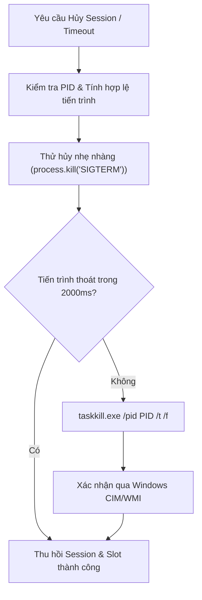
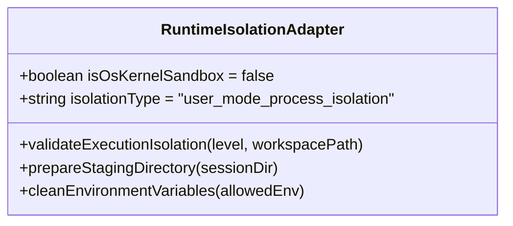

# BÁO CÁO XÁC THỰC RUNTIME & ĐIỀU PHỐI TIẾN TRÌNH G3.0
## PERSONAL AI STUDIO – PROCESS LIFECYCLE & RUNTIME ISOLATION VALIDATION

> **Dự án:** Personal AI Studio  
> **Giai đoạn:** G3.0 – System Integration Testing & End-to-End Validation  
> **Mục tiêu:** Kiểm định vòng đời tiến trình, hủy cây tiến trình không để sót tiến trình con mồ côi (Zombie Process), phát hiện Windows PID Reuse và khẳng định tính trung thực kỹ thuật của mô hình cách ly Runtime.

---

### 1. QUẢN LÝ VÒNG ĐỜI TIẾN TRÌNH TRÊN WINDOWS (PROCESS LIFECYCLE & TREE TERMINATION)

Trên môi trường Windows, khi một tiến trình AI Agent (như Node.js, Python, Antigravity CLI, OpenAI Codex) khởi chạy các tiến trình con (sub-processes, compilers, build tools), việc chỉ gọi `childProcess.kill()` thông thường thường chỉ đóng tiến trình cha và để lại toàn bộ cây tiến trình con chạy ngầm không kiểm soát.

`ProcessRunner` giải quyết triệt để vấn đề này thông qua cơ chế quản lý 2 tầng:

1. **Khởi chạy trực tiếp (Direct Executable Resolution):** Tuyệt đối không truyền lệnh qua `cmd.exe /c` hoặc `powershell -Command` để chống Command Injection. Mọi file thực thi đều được giải quyết tuyệt đối qua `WindowsExecutableResolver` (Assertion 30, 31).
2. **Cưỡng chế hủy toàn bộ cây tiến trình:** Khi cần dừng khẩn cấp hoặc khi tiến trình bị treo, hệ thống thực thi `taskkill.exe /pid <PID> /t /f` với cờ `/t` (Tree kill) và `/f` (Force). Lệnh được gọi trực tiếp không thông qua shell, bảo đảm toàn bộ cây tiến trình con bị triệt tiêu hoàn toàn (Assertion 32).
3. **Phòng tránh tấn công PID Reuse (PID Recycling Guard):**
   Trước khi gửi tín hiệu `taskkill`, `ProcessRunner` xác minh danh tính tiến trình (Process Identity) bằng cách so khớp thời điểm khởi tạo tiến trình (`CreationDate` lấy qua Windows CIM) với bản ghi ban đầu trong bảng `runtime_sessions`. Nếu PID cũ đã bị hệ điều hành cấp phát lại cho một tiến trình khác của hệ thống, `ProcessRunner` lập tức hủy bỏ thao tác `taskkill` để tránh giết nhầm tiến trình vô can (Assertion 33).

---

### 2. TÍNH TRUNG THỰC KỸ THUẬT VỀ CÔ LẬP TIẾN TRÌNH (ISOLATION HONESTY)

Nhiều hệ thống AI tuyên bố có "Sandbox an toàn" nhưng thực chất chỉ chạy tiến trình thông thường trong một thư mục con. Personal AI Studio tuân thủ nguyên tắc trung thực kỹ thuật tuyệt đối:

1. **Không giả lập Sandbox mức Kernel:**
   Trong `RuntimeIsolationAdapter.getCapabilities()`:
   - Thuộc tính `isOsKernelSandbox` được khai báo minh bạch là `false`.
   - Khi cấu hình yêu cầu cấp độ `full_sandbox` (đòi hỏi Windows AppContainer hoặc kernel driver filter mà Node.js không thể cung cấp nguyên bản), hệ thống từ chối an toàn với mã lỗi `SANDBOX_LEVEL_UNSUPPORTED` thay vì lừa dối người dùng (Assertion 34).
2. **Cô lập không gian làm việc thực tế (Staging Directory Isolation):**
   Tiến trình chỉ được phép truy cập thư mục Staging riêng biệt được chuẩn bị tại `storage/staging/<session_id>`. Mọi tệp sinh ra phải đi qua cổng kiểm duyệt của `ArtifactExchangeService` trước khi được ghi nhận vào Workspace chính (Assertion 35).
3. **Tiêm biến môi trường sạch (Clean Environment Injection):**
   Tiến trình chỉ nhận danh sách biến môi trường tối thiểu cần thiết (`PATH`, `SYSTEMROOT`, `TEMP`, `TMP`). Toàn bộ biến môi trường của máy chủ, token nhạy cảm trong shell cha đều bị lọc bỏ hoàn toàn (Assertion 35).

