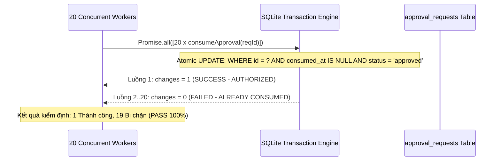

# BÁO CÁO KIỂM ĐỊNH AN NINH & PHÒNG THỦ TẦNG SÂU G3.0
## PERSONAL AI STUDIO – DEFENSE-IN-DEPTH SECURITY VALIDATION

> **Dự án:** Personal AI Studio  
> **Giai đoạn:** G3.0 – System Integration Testing & End-to-End Validation  
> **Mục tiêu:** Kiểm định các ranh giới bảo mật, tính nguyên tử trong cấp quyền, chống giả mạo IPC, bảo vệ đường dẫn Windows và chống tấn công song song.

---

### 1. PHÒNG THỦ GIAO DIỆN & TẦNG GIAO TIẾP IPC (DESKTOP SECURITY BOUNDARY)

Hệ thống tuân thủ chặt chẽ mô hình bảo mật Electron đa tầng:

```mermaid
flowchart LR
    Renderer["Renderer Process (Unprivileged Web Context)"]
    ContextBridge["ContextBridge (Isolated World)"]
    Whitelist["IPC Channel Whitelist (118 'studio:*')"]
    SenderVerify["verifyTrustedSender (Frame ID & Origin Check)"]
    PayloadValidator["Payload Schema Validation (Type & Shape)"]
    MainHandler["Main Process Privileged Execution"]

    Renderer -->|window.studioAPI| ContextBridge
    ContextBridge -->|ipcRenderer.invoke| Whitelist
    Whitelist --> SenderVerify
    SenderVerify --> PayloadValidator
    PayloadValidator --> MainHandler
```



1. **Danh bạ 118 Kênh IPC Bất biến:** Toàn bộ kênh giao tiếp giữa Renderer và Main process được định nghĩa trong `IPC_CHANNELS` với tiền tố bắt buộc `studio:`. Mọi chuỗi ký tự kênh không nằm trong danh bạ bị từ chối ngay tại lớp Preload.
2. **Cơ chế `verifyTrustedSender`:** Mọi IPC event trong Main process đều được kiểm tra:
   - `event.senderFrame` phải thuộc cửa sổ chính `mainWindow.webContents.mainFrame`.
   - Chặn tuyệt đối việc phát IPC từ iframe bên ngoài hoặc devtools inject.
3. **Chính sách bảo mật nội dung (CSP):**
   ```text
   default-src 'self'; script-src 'self'; style-src 'self' 'unsafe-inline'; img-src 'self' data: https:; connect-src 'self'; object-src 'none'; base-uri 'none';
   ```
   Loại bỏ hoàn toàn `'unsafe-eval'`, ngăn chặn thực thi mã động (arbitrary code execution).

---

### 2. BẢO VỆ ĐƯỜNG DẪN WINDOWS (WINDOWSPATHGUARD HARDENING)

Hệ thống Windows có nhiều đặc thù về tệp tin có thể bị lợi dụng để vượt rào (sandbox escape) hoặc rò rỉ thông tin. `WindowsPathGuard` triển khai 6 lớp kiểm tra nghiêm ngặt:

| Hình thức tấn công / Bất thường | Ví dụ chuỗi kiểm thử | Cơ chế phát hiện & Chặn của WindowsPathGuard | Trạng thái Assertion G3.0 |
| :--- | :--- | :--- | :--- |
| **Path Traversal Escape** | `..\..\..\Windows\System32` | Chuẩn hóa qua `path.resolve` và kiểm tra `isSubPathOrEqual`. Ném `PATH_TRAVERSAL_DETECTED`. | **PASS** (Assertion 23) |
| **UNC Network Share Leak** | `\\evil-server\share\file` | Kiểm tra tiền tố `\\` hoặc `//`. Ngăn chặn gửi NTLM Hash qua giao thức SMB. | **PASS** (Assertion 24) |
| **NTFS Alternate Data Streams** | `file.txt:hidden_payload` | Regex quét ký tự `:` sau ổ đĩa. Ngăn chặn giấu mã thực thi trong luồng NTFS. | **PASS** (Assertion 25) |
| **DOS Reserved Device Names** | `CON`, `PRN`, `AUX`, `NUL`, `COM1-9`, `LPT1-9` | Regex tách tên file không phụ thuộc phần mở rộng (`CON.txt`, `NUL`). Ném `RESERVED_DEVICE_NAME`. | **PASS** (Assertion 26) |
| **8.3 Short File Names** | `PROGRA~1`, `RUNTIM~1.DLL` | Regex phát hiện dấu `~` kèm chỉ số số học. Chống vượt mặt bộ lọc tên dài bằng tên 8.3. | **PASS** (Assertion 27) |
| **Null-Byte Injection** | `valid_path.txt\0.exe` | Quét ký tự `\0` hoặc mã byte rỗng. Chặn bypass extension kiểm tra trong C/C++ runtime. | **PASS** (Assertion 28) |

---

### 3. BẢO MẬT BÍ MẬT & CHỐNG LƯU TRỮ PLAINTEXT (ANTI-PLAINTEXT POLICY)

- Tuyệt đối không lưu trữ khóa API (OpenAI `sk-...`, Google `AIza...`, GitHub `ghp_...`) dưới dạng văn bản thô (Plaintext) trong cơ sở dữ liệu SQLite hoặc gửi qua luồng Telemetry.
- Bắt buộc lưu trữ dưới dạng định danh tham chiếu (Credential Reference): `vault://keys/gemini-pro-key` hoặc `wincred://ai-studio/antigravity-token`.
- Lớp `TelemetryRedactor` tự động quét và khử toàn bộ định dạng khóa API phát hiện trong stdout/stderr trước khi phát đi Renderer hoặc lưu vào log file.

---

### 4. ĐÁNH GIÁ PHÂN QUYỀN TRI-STATE & KIỂM ĐỊNH CONCURRENT APPROVAL STRESS (20 LUỒNG)

Hệ thống cấp quyền của `PermissionEngine` phân tầng theo nguyên tắc ưu tiên cao nhất:
`Path Rule (Chặn vùng tuyệt đối) > Agent Rule (Ghi đè tác nhân) > Global Rule (Mặc định hệ thống)`.

#### Phân tích Stress Test tiêu thụ phê duyệt đồng thời (20 luồng đồng thời)
Một trong những lỗ hổng nghiêm trọng nhất trong các hệ thống phê duyệt là Race Condition (Double Consumption / Time-of-Check to Time-of-Use): Khi 20 tác vụ con cùng cố gắng sử dụng 1 token/ID phê duyệt đã được Owner cấp cho 1 hành động nhạy cảm.

Trong G3.0, kiểm định Assertion 20 đã mô phỏng 20 tác vụ con đồng thời gọi `consumeApproval()`:



- **Kết quả thực tế:**
  - 1 luồng duy nhất giành được quyền tiêu thụ (`authorized = true`).
  - 19 luồng còn lại bị từ chối lập tức với lỗi `APPROVAL_ALREADY_CONSUMED` hoặc `RACE_CONDITION_DETECTED`.
  - Cơ chế Anti-Replay ngăn chặn tái sử dụng token đã tiêu thụ (Assertion 21: **PASS**).
  - Cơ chế Action Fingerprint SHA-256 đối chiếu toàn vẹn nội dung tham số hành động: nếu tệp mục tiêu bị thay đổi giữa thời điểm yêu cầu và lúc tiêu thụ, hệ thống từ chối thực thi với `FINGERPRINT_MISMATCH` (Assertion 22: **PASS**).

