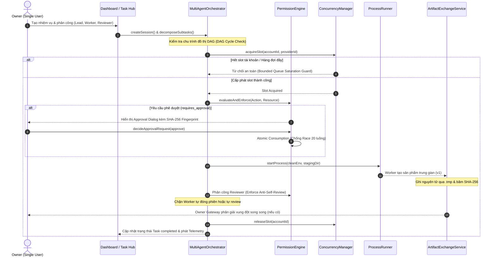

# BÁO CÁO TỔNG THỂ TÍCH HỢP HỆ THỐNG G3.0
## PERSONAL AI STUDIO – SYSTEM INTEGRATION & END-TO-END ARCHITECTURE OVERVIEW

> **Dự án:** Personal AI Studio  
> **Giai đoạn:** G3.0 – System Integration Testing & End-to-End Validation  
> **Môi trường vận hành:** Windows 11 Pro 64-bit | Node.js v24.18.0 | Electron v36.9.5 | SQLite 3.53.1 (WAL Mode)  
> **Mô hình sở hữu:** Single Owner Only (Đơn người dùng, tuyệt đối không phân quyền RBAC/phòng ban)  
> **Nguyên tắc Git:** Nhánh `main`, không tạo branch phụ, zero auto-commit/push/merge.

---

### 1. TỔNG QUAN HỆ THỐNG TÍCH HỢP (G2.1 – G2.10)

Personal AI Studio là trạm điều hành cục bộ (Desktop Control Station) dành cho một Owner duy nhất điều phối, giám sát, cấp quyền và cộng tác cùng nhiều AI Agent hoạt động trên nhiều Provider và Runtime khác nhau (Antigravity CLI, OpenAI Codex CLI, Custom Shell Process, Mock Runtime).

Trải qua 10 giai đoạn phát triển nền tảng (G1 đến G2.10), hệ thống đã đạt độ trưởng thành toàn diện về mặt kiến trúc, hoạt động theo mô hình phân tầng chặt chẽ:

```mermaid
flowchart TD
    subgraph UI_Layer ["Renderer Process (React 19 + Vite + TypeScript)"]
        UI_Dash["Dashboard & Telemetry Stream Monitor"]
        UI_Perm["Permission & Approval Center"]
        UI_Collab["Multi-Agent Workspace & Task Hub"]
        UI_Usage["Usage Ledger, Quotas & Alerts"]
        UI_Unity["Unity 2D Integrity Dashboard"]
    end

    subgraph IPC_Bridge ["Strict IPC Isolation Boundary (ContextBridge)"]
        IPC_Contract["Typed IPC Whitelist (118 'studio:*' channels)"]
        IPC_Validator["verifyTrustedSender + Schema Payload Validator"]
    end

    subgraph Main_Process ["Main Process Orchestration Engine"]
        TaskOrch["Task & Multi-Agent Orchestrator"]
        PermEngine["Permission Engine & Approval System"]
        PathGuard["WindowsPathGuard & Meta Integrity Guard"]
        ConcurMgr["3-Tier Concurrency & RuntimeLockManager"]
        ProcMgr["ProcessRunner & WindowsExecutableResolver"]
        TelemBroker["TelemetryBroker + Redactor + HMAC Signer"]
        ArtExchange["ArtifactExchangeService (Atomic & Immutable)"]
        ResMon["ResourceMonitor (Native Node.js fs.statfsSync)"]
    end

    subgraph Persistence_Layer ["Local Persistence & Storage (C:\\AI-Studio\\storage)"]
        SQLite["SQLite 3.53.1 WAL (studio.db - Schema v9)"]
        BackupStore["Backup & Manifest Store (storage/backups/)"]
        ArtifactStore["Artifact Versioned Store (storage/artifacts/)"]
        LogsStore["Telemetry & Audit Store (storage/logs/)"]
    end

    UI_Layer --> IPC_Bridge
    IPC_Bridge --> Main_Process
    Main_Process --> Persistence_Layer
```

---

### 2. MA TRẬN TƯƠNG TÁC MODULE XUYÊN SUỐT G2.1 – G2.10

| Thành phần | Phụ thuộc chính | Chức năng cốt lõi | Cơ chế bảo vệ & Toàn vẹn |
| :--- | :--- | :--- | :--- |
| **Electron Shell & IPC** (`G2.1`) | Electron, Preload, ContextBridge | Khởi tạo cửa sổ Desktop, cô lập Renderer, cung cấp danh bạ 118 kênh IPC | Whitelist bắt buộc tiền tố `studio:`, `verifyTrustedSender`, CSP siết chặt không `unsafe-eval`. |
| **DatabaseClient** (`G2.2`, `G2.10`) | Node.js SQLite (`node:sqlite`) | Quản lý 57 bảng dữ liệu, 9 schema migrations, statement caching | PRAGMA foreign_keys = ON, WAL mode, transaction guard, atomic backup/restore. |
| **PermissionEngine** (`G2.3`, `G2.10`) | DatabaseClient, WindowsPathGuard | Đánh giá phân quyền Tri-state (`allowed`, `denied`, `requires_approval`), quản lý phê duyệt của Owner | Atomic Consumption (`UPDATE ... WHERE consumed_at IS NULL`), Anti-replay, SHA-256 Action Fingerprint. |
| **TaskOrchestrator** (`G2.4`, `G2.9`) | DatabaseClient, PermissionEngine | Quản lý vòng đời Task, phân công Multi-Agent (Lead, Worker, Reviewer, Observer), DAG decomposition | DAG Cycle Detection, Bounded Retries (<= 3), Anti-Self-Review, Lead-only status transition. |
| **WorkspaceManager & Unity** (`G2.5`) | Node.js `fs`, WindowsPathGuard | Quản lý workspace dự án, phân tích Unity 2D (`m_DefaultBehaviorMode: 1`), bảo vệ tệp C# và `.meta` | Unity Meta Integrity Guard phát hiện `missing_meta`, `orphan_meta`, `duplicate_guid`. |
| **ProcessRunner & Runtime** (`G2.6`, `G2.10`) | Node.js `child_process`, Win CIM | Khởi chạy CLI/Process cách ly, quản lý cây tiến trình, biến môi trường sạch | WindowsExecutableResolver định vị thực thi an toàn, `taskkill /t /f` không qua shell, PID reuse guard. |
| **TelemetryBroker** (`G2.7`) | DatabaseClient, EventEmitter | Thu thập stdout/stderr, luồng sự kiện theo thời gian thực, stream sequence | HMAC-SHA256 signature, Deduplication, Sequence gap detection, ANSI & Secret Redactor. |
| **Usage & Concurrency** (`G2.8`) | DatabaseClient, ConcurrencyManager | Theo dõi token, quota, chi phí, giới hạn đồng thời 3 cấp (Runtime, Provider, Account) | Phân tách hạn mức độc lập, Account Isolation tuyệt đối, Bounded queue saturation guard. |
| **ArtifactExchange** (`G2.9`, `G2.10`) | Node.js `fs`, `crypto`, DatabaseClient | Trao đổi sản phẩm giữa các Agent, lưu trữ bất biến (Immutable versioning) | Atomic file write (`.tmp` -> atomic rename), SHA-256 verification, Storage Reconciliation. |
| **ResourceMonitor** (`G2.10`) | Node.js `os`, `fs`, `process` | Giám sát tài nguyên phần cứng (RAM, Heap, Disk Storage, SQLite size) | `fs.statfsSync` nguyên bản Node.js (không dùng lệnh CLI ngoài), Health Status cảnh báo đa tầng. |

---

### 3. SƠ ĐỒ VÒNG ĐỜI THỰC THI NHIỆM VỤ ĐA AGENT (COLLABORATION PIPELINE)

---

### 4. ĐÁNH GIÁ ĐỘ SẴN SÀNG TOÀN HỆ THỐNG

1. **Tính hoàn chỉnh dữ liệu (Data Completeness):** Toàn bộ 57 bảng cơ sở dữ liệu SQLite tại Schema v9 được định hình nhất quán, 0 vi phạm khóa ngoại, 100% kiểm tra `PRAGMA integrity_check` đạt `ok`.
2. **Khả năng phục hồi sự cố (Disaster Recovery):** Cơ chế khôi phục cơ sở dữ liệu nguyên tử (Atomic Replace) kết hợp sao lưu phòng ngừa (Pre-restore backup) và tự phục hồi phiên sau sự cố khởi động lại (Restart Recovery) hoạt động bền bỉ, không ghi nhận tình trạng rách dữ liệu.
3. **Hiệu năng vận hành (Performance & Scalability):** Tải hàng loạt 10 Agent và 50 Task hoàn tất dưới 5ms; 100 truy vấn tuần tự qua Prepared Statement Cache hoàn tất trong 0-1ms; mức chiếm dụng bộ nhớ RAM tiến trình duy trì mức tối ưu (~49MB - 70MB RSS).

